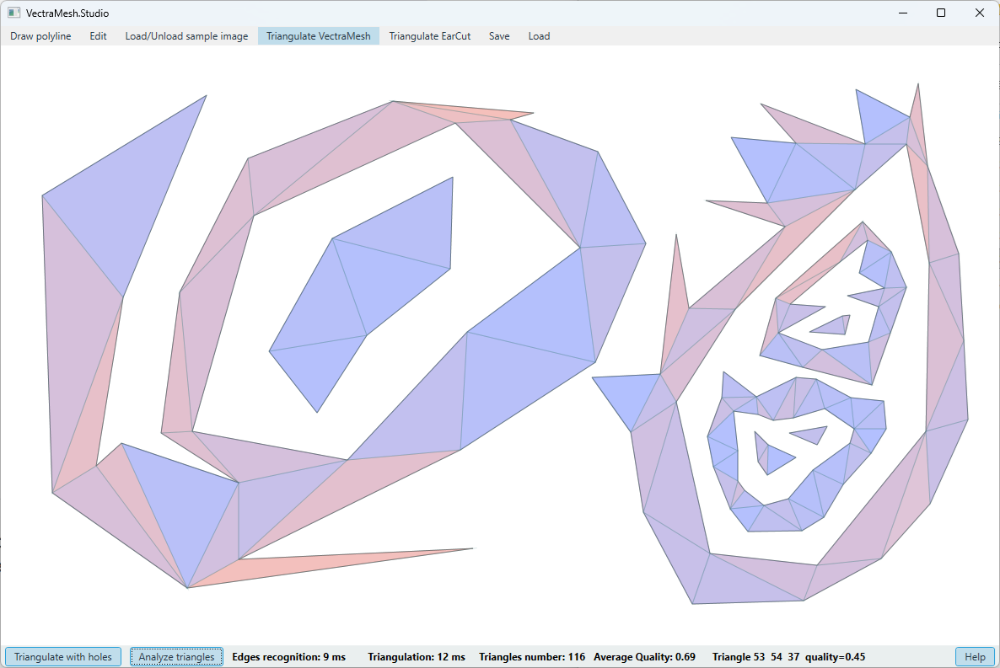
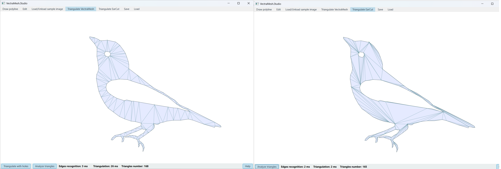
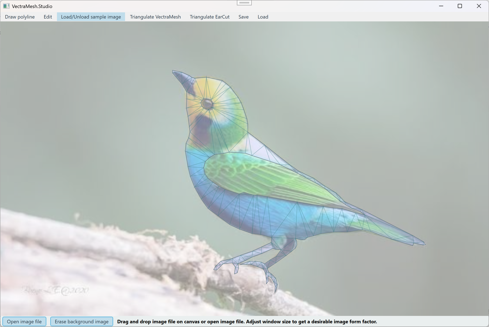

# VectraMesh – High-Precision 2D Triangulation Engine for .NET

**VectraMesh** is a pure, lightweight 2D triangulation and topology analysis library for C# and .NET. Engineered to handle complex real-world geometry—such as winding non-convex polygons, sharp spikes, multi-level nested holes (islands inside holes), and tight tolerances—it validates segment constellations and outputs clean, well-proportioned triangle meshes where standard algorithms produce artifacts or fail.

[](https://www.nuget.org/packages/VectraMesh)
[](https://github.com/VectraMesh/VectraMesh/releases/latest)
[](https://github.com/VectraMesh/VectraMesh/blob/main/LICENSE-FREEWARE.txt)

---

## Pure Math Engine vs. Visual Studio App

The VectraMesh ecosystem is separated into two components to keep integration clean for server, CAD, game, and desktop applications:

1. **`VectraMesh` (NuGet Math Library):** A lightweight, headless `.NET Standard 2.0` / `.NET 8.0+` geometry engine using `System.Numerics.Vector2`. It has **no UI dependencies**—you supply points and segments, and it validates topology and outputs triangle data (with an optional `IVmPresenter` interface for custom rendering).
2. **`VectraMesh.Studio` (Open-Source WPF App):** The companion desktop application in this repository that consumes `VectraMesh` to interactively draw segments, trace background images, diagnose invalid edges, export JSON/WPF test cases, and benchmark results side-by-side against **EarCut**.

---

## Why VectraMesh vs. EarCut?

| Capability | `VectraMesh` | `EarCut` |
| :--- | :---: | :---: |
| **Multi-Level Nested Holes (Islands inside Holes)** | **Built-in (`HoleLevel` hierarchy)** | Manual preprocessing required |
| **Topological Completeness (T = V + 2H - 2)** | **Preserves exact triangle count** | Can collapse sliver triangles on tight multi-hole curves |
| **Topology & Error Segment Validation** | **Built-in (`RecogniseEdges`)** | None (assumes valid rings) |
| **Per-Triangle Quality Metric (Mean Ratio)** | **Built-in (`VmTriangle.Analyze`)** | None |
| **Optional UI Rendering Hook** | **Built-in (`IVmPresenter`)** | None |

---

## Visual Showcase (Rendered in `VectraMesh.Studio`)

### 1. Multi-Level Nested Holes & Quality Diagnostics
`VectraMesh` automatically resolves complex non-convex contours, sharp acute spikes, and **multi-level nested holes** (islands inside holes) while reporting per-triangle Area-to-Edge Mean Ratio quality (`0.69` average quality in `12 ms`):



### 2. Mesh Quality Benchmark: `VectraMesh` vs. `EarCut`
On identical non-convex polygons, **`VectraMesh`** (left) generates balanced, well-proportioned triangles, whereas **`EarCut`** (right) produces long, skinny sliver triangles fanning from a single corner:



### 3. Multi-Hole Tracing & Topological Completeness (`VectraMesh` vs. `EarCut`)
Using **`VectraMesh.Studio`**, you can drag-and-drop any reference image onto the canvas and trace organic silhouettes with multiple interior cutouts. On this 166-vertex contour with 2 interior holes (theoretical count T = V + 2H - 2 = 168 triangles), **`VectraMesh`** (left) preserves the exact **168 triangles** with balanced radial distribution, whereas **`EarCut`** (right) drops 3 sliver triangles (**165 triangles**) and creates long diagonal fans across the body:



---

## 🖥️ Try VectraMesh.Studio (Interactive Windows Demo)

Want to test your own polygons or compare `VectraMesh` against `EarCut` visually before integrating it into your codebase? Download the standalone Windows desktop app from the latest release:

* **Download:** [VectraMesh.Studio-v1.0.0-win-x64.zip (Latest Release)](https://github.com/VectraMesh/VectraMesh/releases/latest)
* **Run:** Extract the ZIP archive to any folder and launch **`VectraMesh.Studio.exe`**.
* **Features:** Load a reference image (`.png`, `.jpg`, `.bmp`, `.gif`) via drag-and-drop, trace contours, inspect error segments visually, export meshes to JSON or WPF `MeshGeometry3D`, and save/load test cases as **JSON**.

> **Note:** On first launch, Windows SmartScreen may display *"Windows protected your PC"* because this indie release is not signed with a paid Authenticode certificate. Click **More info → Run anyway** to start the app.

---

## Design Philosophy: Deferred Topology Analysis

Interactive CAD and GIS editors often require adding, moving, or deleting hundreds of vertices before a drawing is finished. Running heavy topological checks on every single edit would slow down the UI.

**VectraMesh** uses a deliberate three-phase workflow:
1. **Free Editing:** Build or modify any constellation of points and segments without immediate validation overhead (`AddPoint`, `AddSegment`, `SetPosition`, `Erase`).
2. **Batch Topology Analysis (`RecogniseEdges`):** Once editing is complete, run topology recognition to detect outer boundaries, multi-level nested holes, crossings, duplicate segments, or unclosed contours. If errors exist, offending segments are flagged (`ErrorSegments` / `VmSegment.IsError`) so your UI can highlight them immediately.
3. **Triangulation (`TriangulateEdges`):** Triangulate the validated boundaries into clean meshes.

> **State Lifecycle Note:** Modifying points or segments after analysis invalidates the current topology state while keeping previous data accessible in memory. Always call `ClearEdges()` and `ClearErrorSegments()` before re-running `RecogniseEdges()` on updated geometry.

---

## Key Features (`VectraMesh` Engine)
* **Multi-Level Nested Holes:** Automatically classifies outer contours (`HoleLevel = 0`), holes (`HoleLevel = 1`), islands inside holes (`HoleLevel = 2`), and deeper levels—triangulating alternating solid/void regions automatically (or all regions via `withoutGaps: true`).
* **Interactive Topology Diagnostics:** Automatically detects duplicate segments, corner/side intersections, unclosed polygons, and optional nested-hole restrictions—flagging exact `ErrorSegments` for visual feedback.
* **Built-In Mesh Quality Analysis:** Evaluates each triangle's Area-to-Edge Mean Ratio (`0.0` to `1.0`) via `VmTriangle.Analyze()`.
* **Headless & Dependency-Free:** Pure C# math (`System.Numerics.Vector2`) with an optional `IVmPresenter` hook for UI rendering.
* **Broad .NET Compatibility:** Multi-targeted for **`.NET Standard 2.0`** and **`.NET 8.0+`** (runs on .NET Framework 4.6.1+, .NET 8/9/10, Unity, and MAUI).

---

## Quick Start

### 1. Install via NuGet
```bash
dotnet add package VectraMesh
```

### 2. Build, Validate & Triangulate in C#
```csharp
using System;
using VectraMesh;

public static class TriangulationExample
{
    public static void Run()
    {
        var engine = new VmEngine();

        // 1. Add points and connect them with segments
        var a = engine.AddPoint(0f, 0f);
        var b = engine.AddPoint(100f, 0f);
        var c = engine.AddPoint(100f, 100f);
        var d = engine.AddPoint(0f, 100f);

        engine.AddSegment(a, b);
        engine.AddSegment(b, c);
        engine.AddSegment(c, d);
        engine.AddSegment(d, a);

        // 2. Analyze topology and check for diagnostic errors
        engine.RecogniseEdges();
        if (!string.IsNullOrEmpty(engine.Message))
        {
            Console.WriteLine($"Topology error: {engine.Message}");
            return;
        }

        // 3. Generate triangles
        engine.TriangulateEdges();

        foreach (var edge in engine.AllEdges)
        {
            foreach (var triangle in edge.Triangles)
            {
                triangle.Analyze();
                Console.WriteLine(
                    $"Triangle ({triangle.P0.Index}, {triangle.P1.Index}, {triangle.P2.Index}) - Quality: {triangle.AnalysisValue:F2}");
            }
        }
    }
}
```
> **Important:** Always reuse the same `VmPoint` instances (`a`, `b`, `c`, `d`) at shared segment endpoints. Coordinate equality alone does not establish topological connectivity.

📖 **Full API Documentation:** For complete class, method, and lifecycle details, see the **[API Reference Guide](https://github.com/VectraMesh/VectraMesh/blob/main/API-REFERENCE.md)**.

---

## Advanced Meshing: `VectraMesh.Pro` (In Development)

Need curved boundaries or automated cleanup of imperfect input drawings? **`VectraMesh.Pro`** is currently in development and will extend the core engine while keeping the `VectraMesh` namespace unchanged:
* **Curved & Interpolating Segments:** Smooth curves and circular arcs passing directly through user-defined control points, combined with adaptive tessellation across mixed straight and curved boundaries.
